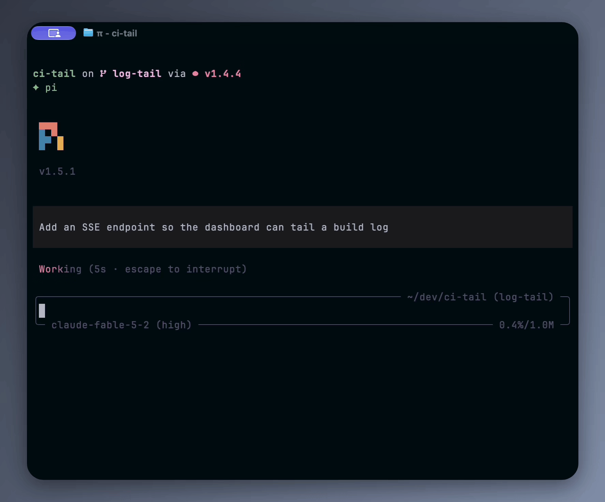

# Pi SearXNG

Web search through your [SearXNG](https://searxng.org) instance and URL fetching for [Pi](https://pi.dev).

## Overview

This extension adds:

- A `web_search` tool that queries your SearXNG instance and returns numbered results with URLs and snippets. Engine warnings, corrections, and suggestions come back with them.
- A `web_fetch` tool that reads a URL as Markdown, plain text, JSON, PDF text, or an image.
- Complete output for large pages and documents. A result too big to return inline is saved to a file first, and the agent gets a preview with the path. Completed PDF downloads are kept as files.
- Compact summaries with measured sizes, such as `460 lines, 13.1KB text`, that expand with Pi's own shortcut.



The recording also uses [Pi TUI Tweaks](https://github.com/blazer2k/pi-extensions/tree/main/packages/pi-tui-tweaks) for the compact tool layout. This package does not change how Pi looks.

## Installation

```bash
pi install npm:@blazer2k/pi-searxng
```

For local development:

```bash
git clone https://github.com/blazer2k/pi-extensions.git
cd pi-extensions
npm install
pi -e ./packages/pi-searxng/src/index.ts
```

The extension needs a running SearXNG instance with the JSON format enabled under `search.formats` in its `settings.yml`. See SearXNG's [Search API](https://docs.searxng.org/dev/search_api.html) documentation.

Set these variables in the environment that starts Pi:

| Variable          | Default                 | Description                                                                   |
| ----------------- | ----------------------- | ----------------------------------------------------------------------------- |
| `SEARXNG_URL`     | `http://localhost:8888` | Base URL of your SearXNG instance.                                            |
| `SEARXNG_API_KEY` | unset                   | Optional Bearer token for search requests. It is never sent to fetched sites. |

## Configuration

Run Pi first, then edit `~/.pi/agent/pi-searxng.json` and run `/reload` in Pi. Changes are loaded only at startup and on reload.

The extension creates the file with defaults when it first loads. Each time it loads, it fills in missing keys, resets invalid values to their defaults, removes unknown keys, and writes the result back to the file. If the file cannot be parsed, the extension reports the error, uses the defaults for that session, and leaves the file as it is.

Export the `PI_SEARXNG_CONFIG_PATH` environment variable to choose a different settings file.

Write boolean and numeric settings without quotes.

## Search

| Setting                | Type          | Default | Description                                                                   |
| ---------------------- | ------------- | ------- | ----------------------------------------------------------------------------- |
| `maxResults`           | integer       | `10`    | Maximum results kept from one search. Any integer from `1`.                   |
| `agentCanLimitResults` | boolean       | `false` | Let the agent ask for fewer results through a `maxResults` argument.          |
| `agentCanPickCategory` | boolean       | `false` | Let the agent choose a `category`: `general`, `news`, `science`, or `videos`. |
| `safesearch`           | `0 \| 1 \| 2` | `0`     | SafeSearch level: off, moderate, or strict.                                   |

Without a category, the search uses your instance's default.

Collapsed, a search shows its result count. Expanded with Pi's shortcut (`Ctrl+O` by default), it lists every returned result with the engine warnings, corrections, and suggestions. Empty results are reported separately from failed requests.

## Fetch

`web_fetch` picks its output from the response's content type:

| Response type                        | Output                                                                                                   |
| ------------------------------------ | -------------------------------------------------------------------------------------------------------- |
| `text/html`, `application/xhtml+xml` | Markdown with source and article metadata. Navigation and promotional blocks are removed conservatively. |
| Other `text/*`                       | The decoded text.                                                                                        |
| `application/json`                   | The original JSON text, checked for valid UTF-8 and syntax.                                              |
| `application/pdf`                    | Extracted text per page. The original file is saved first.                                               |
| `image/*`                            | An image attachment with its format and size.                                                            |

JSON is not re-serialized, so whitespace, duplicate keys, and number spellings stay as sent. Invalid JSON is an error. A PDF without readable text keeps its saved original; the extension does not do OCR.

| Setting             | Type    | Default | Description                                                                                        |
| ------------------- | ------- | ------- | -------------------------------------------------------------------------------------------------- |
| `fetchPreviewLines` | integer | `20`    | Content lines shown when a fetch is expanded. Any positive integer, or `-1` for all returned text. |
| `allowPrivateUrls`  | boolean | `false` | Allow fetching local and private addresses.                                                        |

Collapsed, a fetch shows the measured size of the extracted text, or the page count and text size for a PDF. Expanded, it shows the beginning and end of the returned text with a `+N lines` marker between them. Odd limits give the extra line to the beginning. With a positive limit, long lines are cut to the terminal width; `-1` wraps them. Source details, errors, and file paths are always shown and do not count toward the limit.

Output that fits Pi's inline limits (2,000 lines and 51,200 bytes) is returned in full. Anything larger is saved in full first, and the agent gets a preview with the file path.

| File                                        | Saved when                                                               |
| ------------------------------------------- | ------------------------------------------------------------------------ |
| `original.pdf`                              | Every completed PDF download, before its text is extracted.              |
| `content.md`                                | A converted HTML page is too large to return inline.                     |
| `content.txt`                               | Plain text or PDF text is too large to return inline.                    |
| `content.json`                              | JSON is too large to return inline. The file holds only the JSON.        |
| `content.partial.md`, `content.partial.txt` | A conversion stopped early. The file holds the text accepted until then. |

Files go to a private folder for the session under the system's temporary directory, and each result names the full path. They stay available after `/reload` until the system cleans its temporary directory.

An HTTP error, a timeout, a cancelled call, or a conversion that stopped early is reported as an error, with the path of anything already saved.

## Limits

| Setting                  | Type    | Default      | Description                                                                                              |
| ------------------------ | ------- | ------------ | -------------------------------------------------------------------------------------------------------- |
| `timeoutMs`              | number  | `180000`     | Network deadline for one search or fetch, in milliseconds, including the response body. At least `1000`. |
| `pdfProcessingTimeoutMs` | integer | `300000`     | Deadline for converting a PDF once its original is saved, in milliseconds.                               |
| `maxContentBytes`        | integer | `104857600`  | Largest fetch download in bytes. The same limit applies separately to the extracted text.                |
| `maxSessionStorageBytes` | integer | `1073741824` | Space that one session's saved files may use, in bytes.                                                  |

PDFs are converted page by page in a separate worker, with no page limit. The processing deadline or a cancelled call stops the worker. When session storage is full, new saves fail and earlier files stay. The size defaults of 100 MB and 1,024 MB are provisional, and neither one limits memory use.

## Security

Requests come from the machine that runs Pi. By default, `web_fetch` refuses local and private addresses, including a public hostname that resolves to one and a redirect that leads to one. It always refuses URLs that carry credentials and schemes other than HTTP and HTTPS. `allowPrivateUrls` lifts only the address check.

Search results, fetched pages, and saved files are untrusted input, and the tools tell the agent to treat them that way.

## Compatibility

Requires Pi `1.5.0` or newer and Node.js `22.19.0` or newer. Tested with Pi `1.5.1`.

## License

MIT
